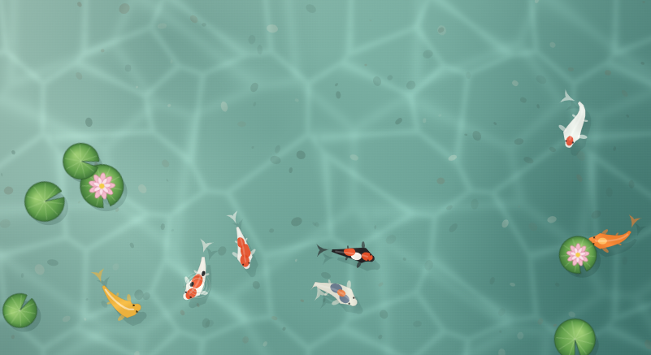

# ClaudeSkin

Live themes for the Claude desktop app. 🐟 **Koi pond**: koi swim under glass panels, follow your cursor, and scatter when you click. 🍁 **Autumn koi**: the koi pond in autumn, Japanese maple and ginkgo leaves drift down, land with a ripple and get nudged by the koi; click for a gust. 🖌️ **Sumi**: ink-wash landscape with a drifting sampan, swaying trees and birds; click to send a flock flying, bamboo grows while Claude is answering. Every launch gets a new random school of koi. 🏺 **Earth**: warm earth tones with liquid glass. ✳️ **Attention**: warm paper, drifting words in many languages; threads follow your cursor, click a word to bloom related words, and a spark wakes up while Claude is answering. Optional **chat words** (Ctrl+Alt+W, off by default): the floating words come from the current conversation instead, extracted locally in memory, nothing sent anywhere.

## Install — let your Claude do it

Give this folder to Claude (Claude Code / Cowork) and say:

> Read AGENT.md in this folder and install the koi theme for me.

Your Claude reads the code first, then guides you through the one step you do by hand: turning on the debugger in the Developer menu.

## Install — by hand

1. Node.js 22+. Claude set to **light** appearance.
2. In Claude: **Developer → Enable Main Process Debugger**.
3. Run `ClaudeSkin.bat` (koi) or `ClaudeSkin-earth.bat` (earth) or `ClaudeSkin-attention.bat` (attention), `ClaudeSkin-autumn.bat`, `ClaudeSkin-sumi.bat`, or `node inject.mjs koi`.
4. **Turn the debugger off again.** The theme keeps running.

**Ctrl+Alt+G** turns the theme on/off. **Ctrl+Alt+↑ / ↓** makes the glass more or less see-through (koi). `ClaudeSkin-off.bat`, or restarting Claude, removes it completely.

**Auto-apply on every start** (only if you keep the Main Process Debugger on): run `ClaudeSkin-autostart.bat [koi|earth|attention|autumn|sumi|auto]` once. A hidden watcher re-applies the theme whenever Claude starts. `auto` = koi from 06:00 to 18:00, autumn koi from 18:00 to 06:00, switching live. Undo with `ClaudeSkin-autostart-off.bat`.

## Is it safe?

- No app files are changed. Nothing is saved to disk. The themes make no network calls and read nothing from your chats. The code is short; read it.
- ⚠️ **While the debugger is on, any program on your computer can control the Claude app.** Only turn it on for the moment you apply the theme, and only run themes whose code you (or your Claude) have read.
- This is unofficial. An app update can change the layout and break the theme. If that happens, restart Claude and everything is back to stock.

---

## Tiếng Việt

Theme động cho app Claude desktop: hồ cá koi bơi dưới lớp kính, cá theo chuột và tản ra khi bạn click. Có thêm hồ koi mùa thu (lá phong Nhật, lá bạch quả rơi) và tranh thủy mặc (thuyền, cây, đàn chim bay khi click). Mỗi lần mở là một đàn koi màu ngẫu nhiên.

**Cách cài nhanh:** ném thư mục này cho Claude của bạn và nói *"Đọc AGENT.md trong thư mục này rồi cài theme koi cho mình"*.

**Cách cài tay:**
1. Cần Node.js 22 trở lên, và Claude để giao diện sáng.
2. Trong Claude, vào **Developer → Enable Main Process Debugger**.
3. Chạy `ClaudeSkin.bat`.
4. **Tắt debugger đi.** Theme vẫn chạy tiếp.

**Ctrl+Alt+G** để bật/tắt theme. **Ctrl+Alt+↑ / ↓** để kính đục hơn hoặc trong hơn (theme koi). Muốn gỡ thì chạy `ClaudeSkin-off.bat` hoặc khởi động lại Claude.

**Tự nạp mỗi lần mở app** (chỉ khi để Debugger bật sẵn): chạy `ClaudeSkin-autostart.bat [koi|earth|attention|autumn|sumi|auto]` một lần. Một tiến trình chạy ẩn sẽ nạp lại theme mỗi khi Claude khởi động. `auto` = koi từ 6h đến 18h, koi mùa thu từ 18h đến 6h, tự đổi khi tới giờ. Gỡ bằng `ClaudeSkin-autostart-off.bat`.

⚠️ Khi debugger đang bật, mọi chương trình trên máy đều điều khiển được app Claude, nên chỉ bật đúng lúc cài theme. Đây là bản không chính thức, app update có thể làm hỏng theme; khởi động lại Claude là về như cũ.

---

MIT License — see [LICENSE](LICENSE).
